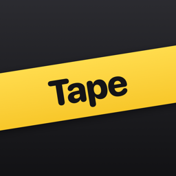
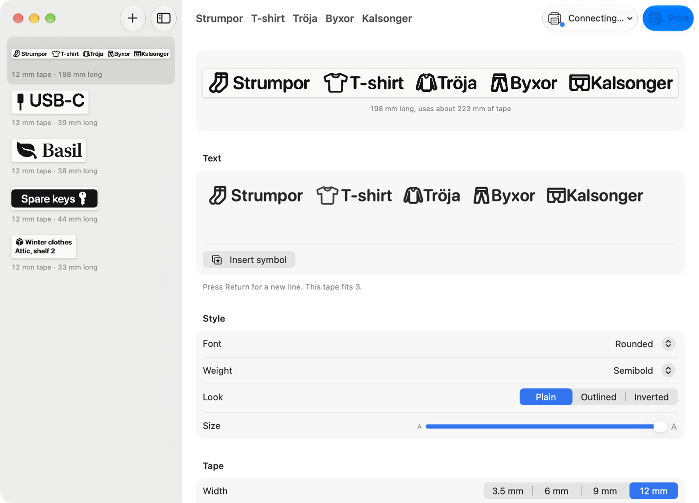
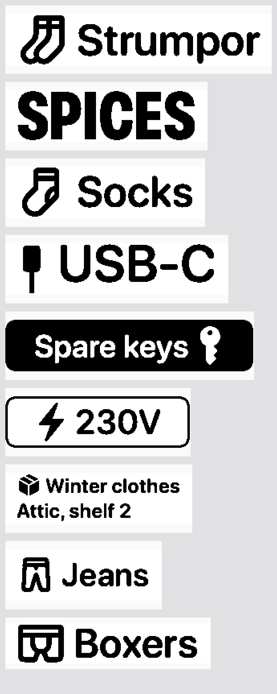
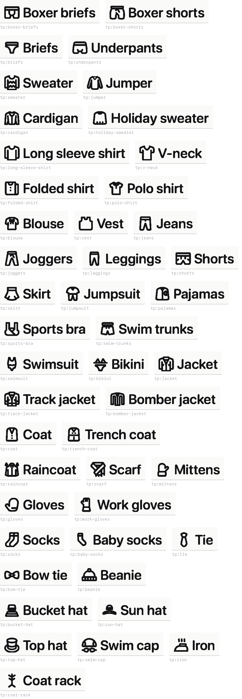

# Tape

A label maker app for the Brother PT-P300BT (the P-touch Cube), for Mac and iPhone. You type a label, drop SF Symbols and clothing icons into the text like letters, and print over Bluetooth. It needs no Brother software or driver.



## What it does

- Type a label of up to three lines and put icons anywhere in the text. An icon behaves like a character, so backspace deletes it.
- Search about 10,000 icons by keyword: SF Symbols, Phosphor, and 46 clothing icons such as boxers, sweaters, scarves and mittens.
- Preview the exact black-and-white image the printer receives, on the colour of the tape you have loaded.
- The app sizes each label so its tallest letter or icon fills the 9 mm the printer can reach, so nothing gets cut off.
- Choose from five fonts and five weights, plus plain, outlined or white-on-black styles, a fixed length and the space at each end.
- See the printer's tape width and colour, battery level and errors in plain words.
- Saved labels stay in a list on the side.



## Download for Mac

1. Download `Tape.zip` from the [latest release](../../releases/latest) and unzip it.
2. Move Tape to Applications and open it.
3. macOS blocks the first launch, because the app isn't notarized by Apple. Open System Settings › Privacy & Security, scroll down to the message about Tape, and click Open Anyway.
4. Allow Bluetooth when Tape asks.

Tape needs macOS 26 or later.

## Pair the printer

On a Mac, turn the printer on, open System Settings › Bluetooth and connect to the PT-P300BT. Tape finds it from there. The printer menu at the top of each label shows the connection.

On an iPhone, turn the printer on, tap the printer button at the top of a label, and choose Pair printer.

## Build it yourself

You need Xcode 26 or later.

```sh
git clone https://github.com/Willayam/tape.git
cd tape
open Tape.xcodeproj
```

Pick the Tape scheme, choose My Mac, and run. The Mac build signs itself locally, so it needs no Apple developer account.

To run it on your iPhone, copy `Config/Local.xcconfig.example` to `Config/Local.xcconfig`. In that copy, set your team ID and a bundle ID of your own, then pick your phone in Xcode. A free Apple ID works, but iOS stops opening those builds after seven days.

The Xcode project comes from `project.yml`. If you change `project.yml`, regenerate the project with [XcodeGen](https://github.com/yonaskolb/XcodeGen) by running `xcodegen generate`.

## How printing works

The PT-P300BT speaks Brother's raster command set over a Bluetooth serial channel. `Shared/Printer/PTCBP.swift` turns the label image into that command stream. Its output matches, byte for byte, what [Ircama/PT-P300BT](https://github.com/Ircama/PT-P300BT) sends. That Python tool prints on this model, and its protocol notes are what made this app possible.

The Mac opens the Bluetooth serial channel with IOBluetooth. The iPhone uses the ExternalAccessory framework, with the `com.brother.ptcbp` protocol listed in `Info.plist`.

The printer has a few fixed limits:
- It prints at 180 dots per inch, on tape 3.5, 6, 9 or 12 mm wide.
- On 12 mm tape, the head reaches only the middle 9 mm, which is 64 dots.
- It feeds about 25 mm of blank tape before every label, and that can't be turned off.

## Status

On a Mac, Tape connects to the printer and reads its status. The iPhone connection hasn't been tried with a real printer yet. Brother doesn't publish the protocol name the iPhone app uses for this model. If the iPhone can't connect, the app shows the name the printer offers instead, so please open an issue with that message.

The print heights for 3.5, 6 and 9 mm tape come from Brother's spec for other P-touch models. They may need adjusting after a test print.

## Icons

- SF Symbols come from macOS. `Scripts/gen_symbols.py` builds their search index from the copy macOS ships.
- [Phosphor](https://phosphoricons.com) (MIT) fills gaps such as pants, socks and dresses. It ships as three fonts in `Shared/Resources/Fonts`, and `Scripts/add_phosphor.py` adds it to the index.
- The TapeIcons font adds clothing that neither set has. `Scripts/build_extra_icons.py` builds it from [Lucide Lab](https://github.com/lucide-icons/lucide-lab) (ISC), [Hugeicons](https://hugeicons.com) (MIT) and [Iconoven](https://iconoven.com) (MIT). It redraws every icon at Phosphor's line widths so the sets match. The source icons are in `Scripts/extra-icons`.

To rebuild `Shared/Resources/symbols.json`, run the three scripts in that order. Each script explains its own arguments at the top.



## Licence

The code is MIT licensed. See [LICENSE](LICENSE). The icon fonts keep their own licences, which sit next to them in `Shared/Resources/Fonts`.

Tape isn't affiliated with Brother. Brother and P-touch are trademarks of Brother Industries.
